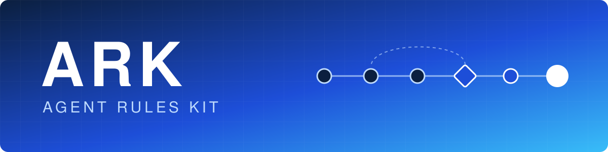
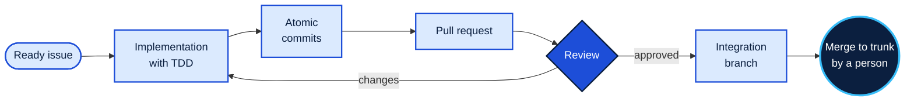

  

  
  

  
  
  
  
  

ARK is the process kit I use to work with
[Claude Code](https://docs.anthropic.com/en/docs/claude-code). It makes the agent
follow the same path I'd expect from anyone on the team: start from an issue, write
the test first, commit in small pieces, open a PR, go through review and leave the
decisions on record. And it does that the same way across all my repositories.

> [!NOTE]
> ARK's source code is private. This page covers what it does and why it was
> designed this way.

<h2 align="center">Why it exists</h2>

An AI agent writes code fast, but on its own it doesn't take care of the rest. It
doesn't know why the issue was opened, says something works without running the
tests, lumps several changes into one commit and doesn't write down the decisions it
made. On a one-week project that goes unnoticed. On a semester-long team project it
turns into rework.

Instead of fixing that project by project, I gathered the rules into a single kit.
When I improve one of them, every repository picks up the new version, and each
project only keeps what is specific to it.

<h2 align="center">How the work moves</h2>

Each step can be used on its own, with someone following along. `/exhaust` puts them
together: it takes the queue of ready issues, in priority order, and carries them one
at a time to the merge. It implements, opens the PR, reviews, fixes and merges with
no one watching. The one thing it doesn't do is merge into trunk. That call is still
a person's.

<h2 align="center">Design decisions</h2>

When `/exhaust` works on its own, merges go to a separate integration branch that can
be thrown away as a whole. If a bug slips past review on the first issue, it doesn't
reach the main project before someone looks at it.

Review checks two different things: whether the PR does what the issue asks while
respecting what the project has already decided, and whether the code itself is
good. Each question has its own reviewer, and each reviewer's criteria are written
down in one place only. At one point the same rule lived copied in more than one command, and
the copies ended up drifting apart.

No unsupervised commit goes in with a failing test. And before implementing, the
agent reads the project's glossary and decision records (ADRs), which is where the
reason behind each choice lives.

<h2 align="center">Where it's been used</h2>

An early version of ARK organized the work of the six-person team behind
[SAGA](https://github.com/PPrauchner/SAGA-Sistema-de-Acompanhamento-e-Gestao-Academica),
a management system for graduate programs. It has since reached version 9.

<h2 align="center">Credits</h2>

Some supporting skills, such as `tdd`, `grill-me` and `triage`, come from
[mattpocock/skills](https://github.com/mattpocock/skills), under the MIT license. The
agent's behavioral principles build on
[multica-ai/andrej-karpathy-skills](https://github.com/multica-ai/andrej-karpathy-skills).
The workflow, agents, rules and architecture decisions are my own.

<h2 align="center">Contact</h2>

ARK is still in development. If you'd like to talk about it:

  
  

