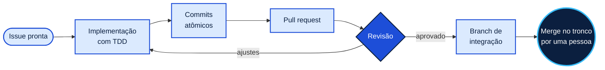

  

  
  

  
  
  
  
  

O ARK é o kit de processo que eu uso para trabalhar com o
[Claude Code](https://docs.anthropic.com/en/docs/claude-code). Ele faz o agente
seguir o mesmo caminho que eu cobraria de qualquer pessoa da equipe: partir de uma
issue, escrever o teste antes, commitar em partes pequenas, abrir PR, passar por
revisão e deixar as decisões registradas. E faz isso do mesmo jeito em todos os meus
repositórios.

> [!NOTE]
> O código do ARK é privado. Esta página conta o que ele faz e por que foi desenhado
> assim.

<h2 align="center">Por que existe</h2>

Um agente de IA escreve código rápido, mas sozinho ele não cuida do resto. Não sabe
por que a issue foi aberta, diz que algo funciona sem ter rodado os testes, junta
várias mudanças no mesmo commit e não anota as decisões que tomou. Num projeto de uma
semana isso passa despercebido. Num projeto de semestre, com equipe, vira retrabalho.

Em vez de corrigir isso em cada projeto, juntei as regras num kit só. Quando melhoro
uma delas, todos os repositórios passam a usar a versão nova, e dentro de cada
projeto fica só o que é específico dele.

<h2 align="center">Como o trabalho anda</h2>

Cada etapa pode ser usada sozinha, com alguém acompanhando. O `/exhaust` junta todas:
pega a fila de issues prontas, na ordem de prioridade, e leva uma por uma até o
merge. Ele implementa, abre o PR, revisa, corrige e mergeia sem ninguém olhando. Só
não mergeia no tronco. Essa decisão continua sendo de uma pessoa.

<h2 align="center">Decisões de design</h2>

Quando o `/exhaust` trabalha sozinho, o merge vai para uma branch de integração
separada, que pode ser jogada fora inteira. Se um erro escapar da revisão na primeira
issue, ele não chega ao projeto principal antes de alguém olhar.

A revisão olha duas coisas diferentes: se o PR faz o que a issue pede, respeitando o
que já foi decidido no projeto, e se o código em si está bom. Cada pergunta tem um
revisor próprio, e o critério de cada um está escrito num lugar só. Já aconteceu de a
mesma regra existir copiada em mais de um comando, e as cópias acabaram ficando diferentes.

Nenhum commit feito sem supervisão entra com teste falhando. E antes de implementar,
o agente lê o glossário do projeto e os registros de decisão (ADRs), que é onde fica
o porquê de cada escolha.

<h2 align="center">Onde já foi usado</h2>

Uma versão inicial do ARK organizou o trabalho da equipe de seis pessoas do
[SAGA](https://github.com/PPrauchner/SAGA-Sistema-de-Acompanhamento-e-Gestao-Academica),
um sistema de gestão para programas de pós-graduação. Desde então ele chegou à
versão 9.

<h2 align="center">Créditos</h2>

Algumas skills de apoio, como `tdd`, `grill-me` e `triage`, vêm do
[mattpocock/skills](https://github.com/mattpocock/skills), sob licença MIT. Os
princípios de comportamento do agente partem do
[multica-ai/andrej-karpathy-skills](https://github.com/multica-ai/andrej-karpathy-skills).
O fluxo, os agentes, as regras e as decisões de arquitetura são meus.

<h2 align="center">Contato</h2>

O ARK segue em desenvolvimento. Também ajudo equipes pequenas a montar esse fluxo nos repositórios delas. Se faz sentido para a sua, me chama no LinkedIn.

  
  
  

